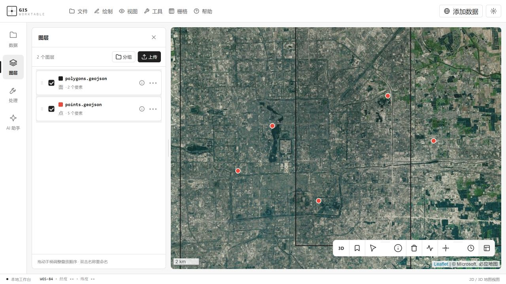

<p align="center">
  
</p>

# GIS WorkTable

结合自然语言 AI Agent 与手动工具的开源 GIS 工作台，用于空间数据处理、分析及 2D/3D 地图可视化。

[](LICENSE)
[](backend/requirements.txt)

[快速开始](#快速开始) · [功能说明](docs/features.md) · [架构](docs/architecture.md) · [参与贡献](CONTRIBUTING.md) · [更新日志](CHANGELOG.md)

## 项目用途

GIS WorkTable 将数据加载、空间分析、地图展示和结果导出放在同一工作台中。用户可以通过手动面板执行分析，也可以用自然语言让 Agent 组合 GIS 工具，并在地图上检查结果。

界面采用黑白灰布局：顶部菜单、左侧首页 / 数据 / 图层 / 处理 / AI 导航、中央地图及底部工具条。首次访问默认打开首页面板，提供上手指引、一键运行样例与最近工程；后续自动记忆上次打开的面板与收起状态。AI 助手默认收起，各侧面板可关闭、重新打开，并通过与地图之间的分隔条调整宽度。全球数据地图在中央工作区打开，可返回原地图且保持当前状态；经纬度显示在底部状态栏。2D 与 3D 使用同一组工作台入口；在线服务是否可接入取决于协议、服务权限与可用性。

适合 GIS 学习、空间分析原型验证和工作流演示。项目持续开发中；桌面客户端为实验性功能，分析结果需要结合数据质量、坐标系和方法适用性核验。

## 工作台预览



上图使用内置矩形和点样例。地图点要素使用与图层颜色一致的实心圆点和细白边，便于在卫星影像上辨认；界面 Logo 和工具图标使用 PNG / CSS，地图矢量使用 Canvas。

空间分析、统计和栅格等工具窗口可通过右下角拖动调整宽高，支持折叠和关闭。窄窗口的分析标签换行显示；运行状态、返回结果和失败原因显示在当前工具面板中。已验证的操作及尚未验证的范围见 [工具验证记录](docs/tool-validation.md)，本轮用户可见更新见 [更新日志](CHANGELOG.md)。

## 主要能力

| 能力 | 内容 | 使用条件 |
| --- | --- | --- |
| 手动 GIS 操作 | 图层管理、绘制、测量、缓冲、叠置、符号化、属性编辑、处理历史与重跑 | 本地分析无需模型 API Key |
| AI Agent | 自然语言任务规划、工具调用、流式回复、结果产物核对 | 配置兼容 OpenAI 接口的模型服务 |
| 2D/3D 地图 | Leaflet / CesiumJS 共享图层状态，行政区下钻、面要素拉伸展示 | 底图和在线边界服务需要网络 |
| 栅格与空间统计 | 地形分析、遥感指数、插值、自相关、热点与网络分析 | 对应输入数据；部分工具需要在线数据 |
| 数据接入 | 文件导入、GeoSource 目录检索、OGC/ArcGIS 服务、云原生格式 | 数据库快照、服务可用性及授权因来源而异 |
| 工程与互通 | 工程保存与恢复（.giswork）、图层导出（Shapefile/GeoJSON 兼容 QGIS 与 ArcGIS）、地图及报告导出、DAG 工作流、stdio MCP Server | MCP 接入见专门文档 |

完整清单见 [功能说明](docs/features.md)。工具以源代码注册表为准；数据目录的数量与探活结果以实际数据库快照为准。

## 快速开始

### 环境要求

- Python 3.11+，建议使用独立虚拟环境；依赖包含地理计算库。
- 现代浏览器；前端无需 Node.js 构建。
- 桌面版额外需要 Node.js / npm 和 Electron 依赖。
- 使用 AI 时需要模型服务配置；手动本地分析可先不配置模型。

### 安装与启动

以下命令在仓库根目录执行：

```bash
git clone https://gitee.com/wukeeeeee/GIS-WORKTABLE.git
cd GIS-WORKTABLE
python -m venv .venv
```

Windows PowerShell 激活环境：

```powershell
.\.venv\Scripts\Activate.ps1
```

macOS / Linux 激活环境：

```bash
source .venv/bin/activate
```

安装依赖并启动 Web 版：

```bash
python -m pip install -r backend/requirements.txt
python -m uvicorn backend.main:app --host 127.0.0.1 --port 8000
```

浏览器打开 <http://127.0.0.1:8000>。开发时可在启动命令末尾添加 `--reload`。

Windows 可运行 `start.bat` 或 `scripts/start-desktop.bat`。启动器只复用当前仓库的 GIS 服务；默认固定使用 8000，冲突时报错，不自动切换端口，以保持浏览器本地存储地址稳定。可以用环境变量 `GIS_PORT` 手动指定其他端口。`scripts/stop.bat` 只停止默认端口（或 `GIS_PORT` 指定端口上）身份匹配的服务；更新前启动的旧服务请在原窗口按 Ctrl+C 关闭。

Python 解释器依次选择 `GIS_PYTHON`、项目 `.venv`、PATH 中的 Python。上述手动安装命令尚未在全新环境验证，macOS / Linux 也尚未完成平台验收。

### 第一次操作：不配置 AI 也可体验

1. 在地图上绘制一个面，或导入自己的 GeoJSON 文件。
2. 在图层面板选中该图层，打开手动空间分析面板。
3. 选择缓冲区，设置距离与单位并执行。
4. 检查结果图层、属性和处理历史，再导出结果。

使用 AI 时，可针对已加载图层输入：`对图层名为 polygons 的图层做 500 米缓冲区`。图层名应与实际加载的名称一致。

### 配置

- **模型服务**：设置 → AI 模型，填写 Provider、Base URL、模型名和 API Key。配置保存在浏览器 localStorage；调用 AI 时，密钥随请求发送到本地后端，由后端访问所选模型服务。
- **外部数据源**：按需在连接器中配置账号或密钥；无需为本地手动分析配置所有数据源。
- **GeoSource**：默认使用 `data/gis_services.db`；也可能优先读取更新时间更晚的同级 `GeoSource/gis_services.db`。可通过环境变量 `GEOSOURCE_DB_PATH` 指定已有数据库文件。目录条目不代表服务始终可用。
- **本地状态**：会话、任务和处理历史位于 `cache/`，生成产物位于 `output/`；清理前请保存需要保留的工程和结果。

### Windows 脚本与桌面版

依赖安装完成后，可使用根目录 `start.bat` 启动 Web 版，`scripts/stop.bat` 停止服务。

桌面版先安装依赖，再运行 `scripts/start-desktop.bat`：

```bash
cd desktop
npm install
cd ..
```

桌面外壳依赖本机 Python 环境，目前仅有 Windows 人工验证。

## 架构与目录

```text
backend/       FastAPI 入口、Agent、GIS 工具、数据连接器、pytest 测试
frontend/      原生 HTML/CSS/JS、Leaflet 与 CesiumJS
desktop/       Electron 桌面外壳
knowledge/     GIS 方法与知识模块
skills/        项目内 GIS 领域提示文档（不是 Codex skill 安装目录）
data/          GeoSource SQLite 数据库快照
docs/          功能、架构、协作规范与发布文档
```

前端使用 `frontend/js/gis_state.js` 统一管理图层、选中要素和下钻状态；手动工具与 AI 调用复用后端 GIS 工具及图层产物通道。详见 [架构与模块](docs/architecture.md)。

## 开发与贡献

在仓库根目录运行：

```bash
python -m pytest backend/tests/ -q
```

部分测试依赖外部网络或服务，跳过与失败原因应按实际输出记录。测试数量和通过率应附执行环境、命令及提交号，不在 README 中固定写入容易过期的数字。

- [贡献指南](CONTRIBUTING.md)：开发流程、工具扩展、验证与 PR 要求。
- [命名与描述规范](docs/repository-standards.md)：项目名、文件名、分支、提交、Issue/PR、仓库 Description。
- [界面与面板规范](docs/ui-guidelines.md)：黑白灰风格、左侧 AI、数据入口及面板折叠与关闭行为。
- [更新日志](CHANGELOG.md) 与 [发布流程](docs/release-guide.md)：记录变更、版本和验证证据。
- [参赛与项目展示准备](docs/showcase.md)：演示流程、材料清单及待核验事项。
- 问题与建议请提交 [Issue](https://github.com/Wukeeeeee/GIS-WORKTABLE/issues)，尽量附最小复现数据。

## 更多文档

- [AI 对话与工具延迟检查](docs/performance-audit.md)
- [项目路线图](docs/ROADMAP.md)
- [仓库盘点与参赛方向评估](docs/repository-audit.md)
- [功能说明](docs/features.md)
- [架构与模块](docs/architecture.md)
- [MCP Server 配置](docs/mcp_server.md)
- [手动直连工具设计说明](docs/summary_manual_direct_tools.md)
- [3D 地球与下钻调研](docs/research_3d_globe_drilldown.md)

## 已知限制与数据使用

- 结果真实性检查核对已知文件与图层产物，不能证明分析方法或 AI 解读一定正确。
- 卫星影像巡检采用 RGB 启发式初筛，不等同于专业遥感分类。
- DEM 可上传 GeoTIFF，也可通过高程工具获取在线地形数据；在线获取受数据覆盖和网络影响。主地图 3D 视图与工具生成的地形预览是不同能力，不应混为一谈。
- 遥感平台下载、POI、底图、行政边界和 OSM 数据受账号、接口、配额与第三方服务条款约束；超大数据和路网任务可能耗时较长。
- 云原生加载中的预览、抽样或范围过滤可能只展示部分数据，需核对工具输出说明。
- 当前默认启动方式面向本机使用；公开部署前需要单独评估身份认证、工具执行权限及数据隔离。

GIS 结果仅供研究和辅助分析，不替代专业判断。软件许可证不授予第三方底图、影像或数据的额外使用权；使用和分发这些数据时应遵守来源条款。

## 许可证与致谢

项目采用 [MIT License](LICENSE)。Leaflet、CesiumJS、FastAPI、LangGraph、GeoPandas、Shapely、Rasterio 等依赖及第三方数据仍适用各自许可证和使用条款。

卫星影像巡检的算法思路参考 [GeoHarness](https://github.com/Star-Learning/GeoHarness)；空间服务目录关联项目为 [GeoSource](https://github.com/Wukeeeeee/geosource)。
