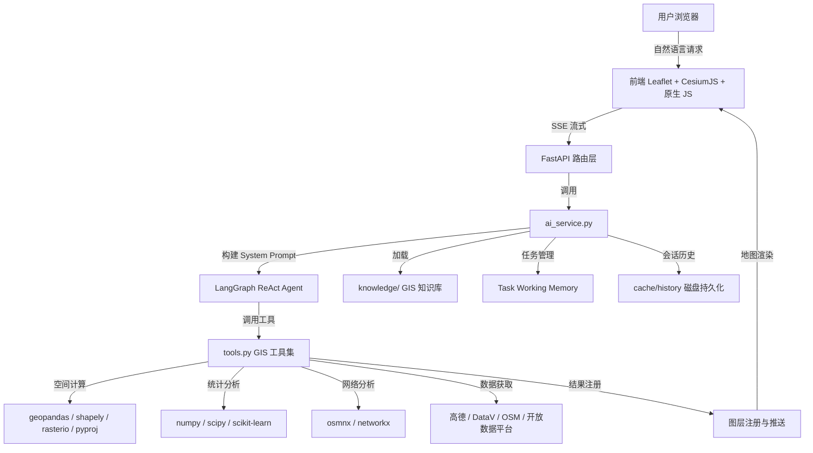

# 架构与模块

## 数据流

前端以 `gis_state.js` 为唯一 GIS 状态源（图层/选中/下钻栈），Leaflet 与 CesiumJS 渲染器只订阅状态事件——2D/3D 同步的是数据状态，不是各自维护一份。

### 模块说明

| 模块 | 位置 | 职责 |
| --- | --- | --- |
| 前端 | `frontend/` | Leaflet 2D + CesiumJS 3D、聊天界面、图层管理、设置面板、工程管理 |
| 共享状态 | `frontend/js/gis_state.js` | 图层/选中/下钻栈唯一数据源，2D/3D/UI 事件同步中枢 |
| 3D 渲染器 | `frontend/js/renderer_cesium.js` | CesiumJS 懒加载（零 Ion）、图层同步、拾取、下钻 UI、视图书签 |
| API 层 | `backend/main.py` | FastAPI 路由、静态文件、文件上传、工程管理接口 |
| AI 服务 | `backend/services/ai_service.py` | System Prompt 构建、知识库路由、会话管理、流式响应 |
| Agent 引擎 | `backend/services/graph.py` | LangGraph ReAct 循环、工具调用、简单文本短路 |
| GIS 工具 | `backend/services/tools.py` | @tool 注册表，供 Agent 与手动入口调用 |
| 知识库 | `knowledge/` | 11 个结构化 GIS 知识模块 |
| 任务管理 | `backend/services/task_manager.py` | Task Working Memory、产物与执行日志 |
| 待确认动作 | `backend/services/pending_action.py` | 跨轮 pending 状态、选项确认、上下文回填 |
| 结果真实性自检 | `backend/services/result_guard.py` | 确定性核对磁盘/内存产物，提示缺失或不一致的产物 |
| 坐标转换 | `backend/services/geo_coords.py` | WGS84 ↔ GCJ-02 ↔ Web Mercator，DataV 边界校正 |
| 凭据存储 | `backend/services/credential_store.py` | Fernet 加密存储、Credential Injection 模式 |
| 工具直连 | `POST /api/tools/invoke` | 手动面板通道：不经 LLM 直接执行 @tool，产物走同一图层通道并自动进历史 |
| 处理历史 | `backend/services/history_service.py` | 工具执行记录（名称/参数/产物/成败）持久化，支持按编号重跑 |
| 云原生加载 | `backend/services/cloud_native.py` | COG / PMTiles / GeoParquet / FlatGeobuf 流式读取助手 |
| 地理质量自检 | `backend/services/geo_qa.py` | 图层出口体检：CRS/坐标范围/几何有效性/空结果警告 |
| MCP Server | `backend/services/mcp_server.py` | stdio MCP，工具开放给外部 AI 客户端，路径 confinement |
| 桌面客户端 | `desktop/` | Electron 外壳：自动拉起/复用后端并加载前端 |

技术栈：Python / FastAPI / LangGraph / GeoPandas / Shapely / Rasterio；前端使用原生 JavaScript、Leaflet 与 CesiumJS；桌面外壳使用 Electron。后端依赖以 `backend/requirements.txt` 为准，桌面依赖以 `desktop/package.json` 为准。
