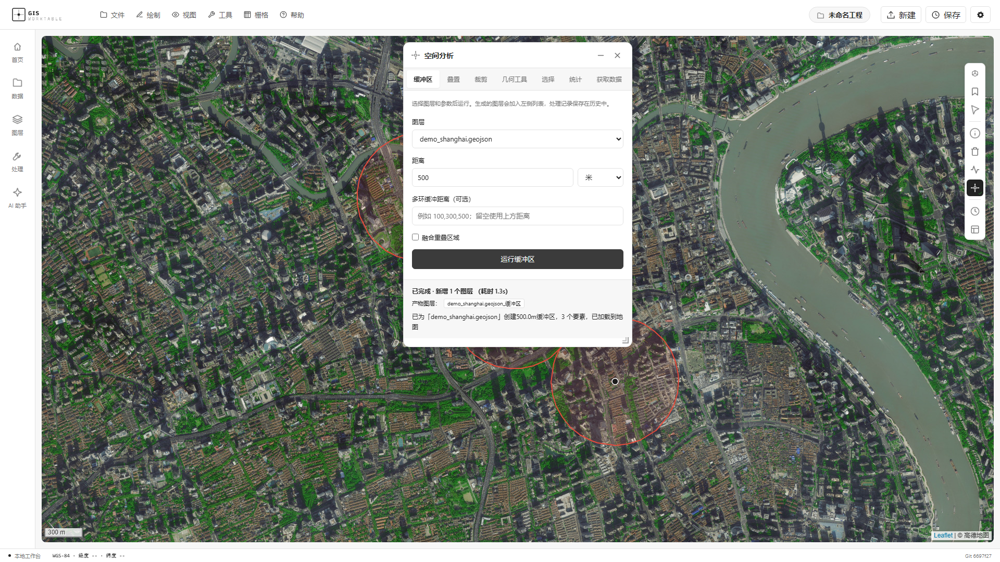
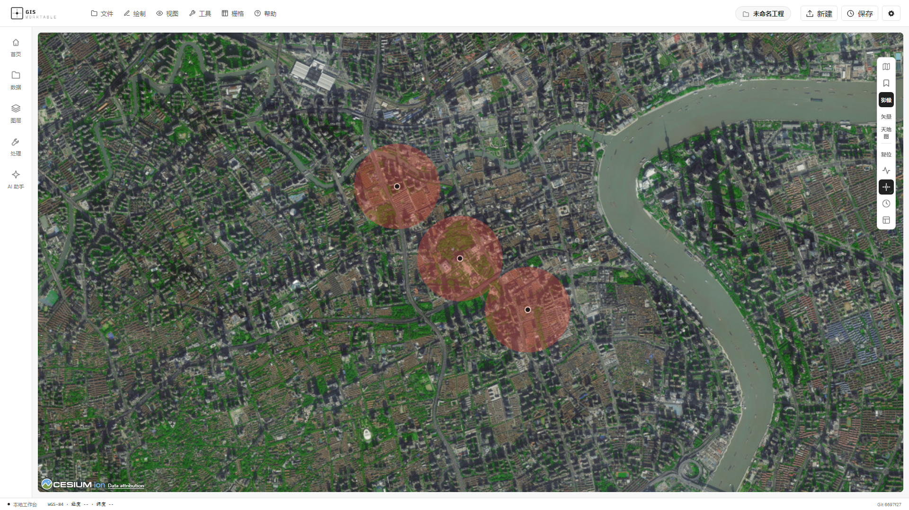

> 同步说明：本介绍由 CN 仓库交付报告迁移。文中的历史截图及 2026-10-16 验收记录来自 CN 仓库，不能作为国际版独立验收结果；国际版迁移检查见 docs/SYNC-2026-10-16.md。

# GIS WorkTable 作品介绍

GIS WorkTable

作品介绍与技术方案

将数据搜索、空间处理与地图表达连接在同一个工作台中。

github.com/Wukeeeeee/GIS-WORKTABLE

MIT License

01  项目概述

## 项目概述

GIS WorkTable 是融合自然语言 AI Agent、手动 GIS 操作与二维/三维可视化的开源空间分析工作台。项目围绕“数据进入工作台之后，如何持续完成分析、核验和交付”组织功能，而不是将聊天界面与地图简单拼接。

执行摘要

项目的主要价值在于把 GIS 的处理能力组织成可连续使用、可检查成果、可继续扩展的工作流。我们以共享工具层连接 AI 与手动入口，以共享图层状态连接二维和三维表达，以执行记录连接用户需求、参数和成果，降低空间任务在不同环节间传递时的上下文损失。

当前交付包含可运行源码、Windows 自动启动脚本、合成复现数据与技术文档。本轮 25 项自动化测试通过；已有运行截图和历史浏览器验收记录支撑本地手动分析链路。真实商业模型调用和异机安装仍需补充验收。项目的差异化优势是可追溯的双入口协作，而不是未经验证的算法精度或行业规模。

建设目标

通过统一的数据与图层状态、共享的 GIS 工具注册表以及可追溯的执行记录，连接数据发现、数据导入、空间处理、地图展示和成果导出。用户既可以通过面板明确控制参数，也可以使用自然语言组织多步骤任务。

项目的整体设计逻辑

GIS WorkTable 将空间任务视为一组持续变化的数据对象与处理步骤。用户发起的请求必须找到对应输入，分析方法必须落到工具参数，计算结果必须回到可查看的图层或文件。这样的组织方式使自然语言、手动操作与成果交付能够建立明确联系，而不是让每个功能各自完成一次孤立操作。

对使用者而言，工作台既提供快速入口，也保留专业核验的位置。初学者可以用自然语言理解和组织任务，熟悉 GIS 的用户可以直接选择方法与参数，两类用户都能通过相同图层与属性表查看结果。项目希望降低的是操作和衔接成本，而不是省略必要的专业判断。

02  项目背景与需求分析

## 项目背景与需求分析

空间信息应用正在从专业部门走向更多业务环节

在互联网与数字化业务环境中，位置、范围、距离、覆盖关系和地形条件成为连接现实世界与信息系统的重要数据维度。低空经济、城市精细化治理、应急响应、生态环境监测与基础设施管理等方向，都需要将多源地理数据转化为可解释、可核验的空间信息。

以低空经济相关的前期空间信息研究为例，起降设施分布、地形背景、周边基础设施及服务覆盖范围可能需要联合查看和处理。这类需求体现了空间分析工作流的普遍价值，但本项目当前定位为通用 GIS 工作台，不提供适航判断、空域审批或飞行安全决策。

地理数据具有来源多样、坐标参考复杂和空间关系敏感的特点。相同区域的点位、行政边界、遥感影像和统计属性往往来自不同渠道，数据之间还存在尺度、时间和格式差异。一个看似简单的覆盖范围问题，可能需要依次检索数据、检查坐标、筛选要素、执行计算、叠加展示并整理交付文件。流程组织因此成为空间分析工具的重要能力。

自然语言交互为降低操作门槛提供了新入口，但专业计算仍需明确的输入、方法和参数。GIS WorkTable 将模型的任务理解与确定性的工具调用连接起来，让自然语言任务最终落到实际图层、执行记录和可导出成果上。

核心问题是工作流分散，而不只是缺少单个算法

| 问题 | 实际影响 | 本项目的应对方向 |
| --- | --- | --- |
| 数据搜索与处理分离 | 在数据网站、目录、下载工具与 GIS 软件间切换，来源与处理上下文容易割裂。 | 将服务目录、文件导入和分析入口集中到工作台。 |
| 中间格式与参数反复转换 | 导出、重新导入、坐标检查和参数重填增加时间成本。 | 让中间结果以图层继续参与后续处理。 |
| 专业操作学习成本 | 用户既要理解方法，也要记住软件入口和操作步骤。 | 提供手动面板与自然语言两类入口。 |
| 聊天结果缺少实物支撑 | 文字回答不一定对应可下载的文件或可查看的图层。 | 记录工具执行与产物，提供结果核查。 |
| 分析过程难以复现 | 临时操作缺少参数记录，重做与交接依赖人工回忆。 | 处理历史、参数留存、重跑和工程保存。 |

因此，项目希望减少不必要的软件切换和重复配置，把更多时间留给分析方法、数据质量与结果解释。

从数据增多到可用信息之间的距离

空间数据可获得性提高，并不自动意味着分析任务更容易完成。不同来源的文件可能采用不同坐标参考，字段定义和更新时间也可能不同。用户需要在数据下载后理解这些差异，确认数据能否用于目标问题。将搜索、导入与检查放在同一工作台中，可以让数据进入分析前的准备环节更容易被看见和追踪。

另一个问题是中间成果管理。传统的临时处理容易产生大量命名相近的文件，任务结束后难以确认哪个版本对应哪组参数。项目通过图层对象、历史记录与工程保存连接中间结果，帮助用户回到实际执行步骤，而不是依赖文件名猜测处理顺序。

03  项目定位与应用场景

## 项目定位与应用场景

项目面向轻量空间分析、教学实验与原型验证，强调“一个工作台连接多个处理环节”。它可以作为已有专业 GIS 工作流的补充，帮助用户快速完成局部分析，再将标准格式成果交给后续系统。

| 用户或场景 | 典型任务 | 可交付结果 |
| --- | --- | --- |
| 学生与教学人员 | 导入样例数据、理解缓冲/叠置/坐标系，比较参数变化。 | 地图图层、属性表、处理记录与导出文件。 |
| 空间数据工作者 | 检索可用服务、整理矢量数据、做局部空间处理。 | 可继续编辑或交给专业软件的标准格式数据。 |
| 城市与设施分析原型 | 研究设施分布、距离关系和覆盖范围。 | 可视化分析原型及参数记录。 |
| 低空经济相关空间研究 | 整理基础地理数据，初步查看地形与设施空间关系。 | 供专业人员进一步研判的空间数据与展示成果。 |
| 开源开发者 | 扩展 GIS 工具、接入数据源或外部 AI 客户端。 | 复用工具接口和现有图层产物通道。 |

产品定位与目标工作负载

我们优先服务单机本地、任务边界清晰、需要交互核验的空间分析场景。用户已有文件或能够接入合法数据源，希望快速串联几个处理步骤并形成标准成果。这样的定位使项目可以聚焦工作流完整性，避免在早期同时承担大型数据平台、专业行业系统和多人生产调度的全部复杂度。

场景示例：从设施点位到服务覆盖表达

用户导入设施点位，检查坐标与属性，设置缓冲距离生成影响范围，再与区域边界或其他图层进行叠置，查看属性统计并导出成果。在这个过程中，原始数据、中间图层和处理参数保留在同一工作台中，有助于减少“下载后换软件、分析后再换软件展示”的往返。

使用边界

服务覆盖或距离分析只是对空间关系的建模，不能直接替代现实道路可达性、运行许可或业务约束。低空经济等高要求场景仍需补齐行业数据、模型与专业审查；本项目不将通用空间计算等同于行业认证结论。

04  核心功能体系

## 核心功能体系

功能围绕“发现与导入 → 分析与编辑 → 核验与表达 → 保存与交付”四个阶段组织。AI 入口负责理解和编排，手动入口提供明确参数控制，两者复用底层工具。

| 功能模块 | 主要能力 | 用户价值 |
| --- | --- | --- |
| 数据获取与接入 | 本地文件导入、GeoSource 服务目录、OGC/ArcGIS 服务接入与云原生格式加载。 | 减少检索、下载和分析之间的断点。 |
| 矢量处理与编辑 | 缓冲、裁剪、相交、融合、简化、空间连接、几何修复与字段管理。 | 完成常见空间数据处理，保留中间结果。 |
| 栅格与遥感 | 地形分析、遥感指数、栅格计算、裁剪和插值。 | 连接影像、地形与矢量分析任务。 |
| 空间统计与网络分析 | 热点、自相关、核密度、路径与服务区等工具。 | 支持空间分布和关联关系的探索。 |
| 地图与属性核验 | 图层管理、符号化、属性表、二维/三维切换及行政区下钻。 | 从地图与数据两个角度查看成果。 |
| 工程与成果管理 | 工程保存/恢复、GeoJSON/Shapefile 导出、处理历史及重跑。 | 支持复现、交接与继续分析。 |
| AI 与外部工具协作 | 自然语言编排、会话上下文、流式输出及 stdio MCP 接口。 | 提供多样化的任务入口与扩展方式。 |

数据发现与分析连续衔接

数据接入不仅是把文件放到地图上，还需要让输入成为可被工具引用的对象。项目通过服务目录、文件导入和图层注册将数据带入工作空间，后续工具围绕图层名和参数继续执行。云原生格式助手提供按需读取与空间过滤等入口，具体行为受格式、数据规模和远端能力影响。

功能可用性说明

本地手动分析不依赖模型 API Key。在线数据请求、底图服务和云端模型调用仍受网络、凭据、配额及服务条款影响。不同部署档位可能限制工具或数据源；工具存在不等于所有外部数据源在任何环境下均可访问。

图层与属性是分析协作的基础

图层管理连接数据和后续操作：用户可以调整显隐、透明度与顺序，检查几何位置，并在属性表中定位或筛选要素。对于空间分析，地图能帮助识别范围异常，属性表能帮助发现字段缺失或统计异常，两种视图共同支撑结果检查。

符号化和二维三维展示用于表达数据差异。分级色彩、比例符号或数值拉伸能够把字段转化为可观察的空间模式，但表达效果依赖字段含义、分类方法与数据尺度。工作台提供这些交互入口，使用户能结合数据含义调整表达，而不是把默认样式当作最终分析结论。

矢量与栅格能力的组合价值

矢量工具适合处理设施点位、道路和区域边界之间的空间关系；栅格工具适合地形或影像的连续空间信息。项目把两类工具集中在工作台中，便于用户围绕同一区域组织任务。例如先检查区域边界，再进行地形处理或影像指数计算，最后把结果叠加到地图查看。

空间统计和网络分析扩展了距离及覆盖问题的表达方式。直线缓冲、道路可达性与热点分布对应不同假设，不能相互替代。工作台的价值是提供可组合的方法入口与成果通道，让用户在明确问题后选择合适工具，并保留参数以便比较。

数据搜索与接入的具体能力

GeoSource 服务目录以 SQLite 索引组织空间服务和图层，支持按关键词、国家和协议等条件检索，帮助用户从目录条目进入可接入的数据服务。服务目录提供发现入口，实际内容及可用性随数据库快照和第三方服务变化；使用者仍需确认覆盖范围、更新时间与使用许可。

| 接入类型 | 工作台中的用途 | 使用条件 |
| --- | --- | --- |
| 本地空间文件 | 把已有数据导入图层，进入分析和属性检查。 | 格式、字段及坐标参考满足导入要求。 |
| OGC 与 ArcGIS 服务 | 通过 WMS、WFS、WMTS、XYZ 或 ArcGIS REST 等入口接入空间服务。 | 源服务在线，且访问方式、权限与数据类型匹配。 |
| 云原生空间格式 | COG、PMTiles、GeoParquet、FlatGeobuf 提供按需读取或预览入口。 | 远端需支持相应访问方式；读取范围和资源开销需控制。 |
| 专题数据连接器 | 接入行政边界、POI、天气等不同来源的数据。 | 受部署档位、凭据、网络和服务配额影响。 |

云原生加载助手针对不同格式采用相应方式：COG 可通过远程读取生成降采样预览，PMTiles 使用按需瓦片访问，GeoParquet 和 FlatGeobuf 可结合空间范围或行数限制控制读取量。这些入口为减少整包下载提供条件，但不能据此推断所有数据集都能获得相同性能。

矢量分析与数据整理

矢量分析围绕点、线、面之间的空间关系展开。缓冲用于表达一定距离范围，裁剪用于限制研究区域，相交与差集用于识别共同或排除区域，空间连接用于把位置关系转换为属性关联。融合、简化和几何修复则服务于数据整理，帮助后续分析获得更清楚的输入。

| 任务目标 | 可选工具或操作 | 常见成果与检查点 |
| --- | --- | --- |
| 查看设施影响范围 | 单环或多环缓冲。 | 范围面图层；检查距离单位、坐标和要素数量。 |
| 限制研究范围 | 裁剪、相交或差集。 | 区域内结果；检查边界和空结果。 |
| 合并或整理几何 | 融合、简化、分解多部件及几何转换。 | 整理后的图层；检查结构变化及属性保留。 |
| 关联位置与属性 | 空间选择、近邻、空间连接和字段统计。 | 关联字段或统计结果；检查匹配规则与重复关系。 |

栅格遥感与空间统计

栅格工具覆盖地形、影像与连续空间信息处理。地形分析包括坡度、坡向、山体阴影和等高线等入口；遥感指数包括 NDVI、NDWI、NDBI 等，依赖正确的传感器波段配置。栅格计算、裁剪和插值可用于构建区域研究流程，输出再进入地图展示或成果文件。

空间统计提供自相关、热点和核密度等工具，用于探索分布与聚集关系。网络分析提供路网下载、路径和服务区等入口，用于研究沿网络的联系。统计方法、权重、带宽、路网通行条件和输入质量会改变结果，因此工具的使用应先明确分析假设，再核对参数与输出。

卫星影像巡检使用地图瓦片开展 RGB 启发式初筛，可输出分类叠加、矢量图层或面积统计。它适合快速观察与教学探索，不等同于经过地面真值验证的专业遥感分类；涉及实际业务判断时需要补充精度评估。

地图表达与成果制作

工作台提供图层排序、显隐、透明度、分组、符号化和属性检查等操作。唯一值、分级色彩、比例符号及数值拉伸把字段转化为可观察表达；卷帘对比帮助用户在同一视图中比较两层数据。行政区下钻与视图书签用于组织区域浏览，二维和三维模式围绕共享图层状态工作。

制图工具还提供图例、标注、指北针、统计图表及静态地图输出等入口。标准格式成果便于转入后续专业 GIS 工作流。GeoJSON 适合保留矢量对象；Shapefile 受几何类型与字段格式限制，混合几何需要拆分，避免导出时丢失部分要素。

AI 编排与专业工具执行

AI 服务根据自然语言目标、会话上下文和工具描述组织调用，GIS 知识模块为方法与参数选择提供辅助。SSE 流式反馈用于呈现任务进展，用户可以结合实际工具调用和成果检查任务是否完成。开放性目标适合由 Agent 辅助组织，已知方法适合直接通过面板执行。

多轮任务中，用户可能继续引用上一轮的图层或区域。上下文管理为这种继承提供基础，待确认动作模块组织需要补充选择的流程。模型生成内容与确定性计算分工明确：模型提供任务理解和编排，空间工具执行计算，质量检查与结果通道提供反馈。

05  典型使用流程与界面展示

## 典型使用流程与界面展示

| 阶段 | 操作与核验重点 |
| --- | --- |
| 1  数据进入 | 导入 GeoJSON 或接入服务；检查坐标、字段和要素数。 |
| 2  参数设置 | 在面板指定输入图层、分析方法与距离；也可由 AI 辅助编排。 |
| 3  工具执行 | 共享工具层完成计算，将结果注册为新图层并记录执行状态。 |
| 4  结果检查 | 查看地图位置、属性字段和要素数，确认结果符合任务预期。 |
| 5  历史与交付 | 检查处理历史、必要时重跑；导出文件并保存工程。 |

例如，在完成 500 米缓冲后，用户可以把结果图层继续交给裁剪或空间连接工具，而不必先导出再导入。自然语言入口也可以在有效上下文中引用已有图层。处理历史使用户能够找回工具名称与实际参数，重跑时产生可继续检查的结果。

图 2  手动缓冲分析。截图采用合成点位，展示真实上传与 500 米缓冲执行结果。

流程中的核验不是可有可无的收尾步骤。缓冲距离的单位、坐标参考系和输入几何质量都会影响结果；工作台提供结果查看与记录，用户仍需复核参数和分析方法。

连续分析的参数与成果管理

在典型任务中，用户可以先采用一组参数生成结果，再调整参数重跑，比较不同结果图层的范围或属性。处理历史记录执行步骤，使用户能够找回采用过的方法；工程保存则让图层组织和已有成果在后续会话中继续使用。

这一过程也提供了错误定位路径。如果结果位置异常，可以回看坐标与输入图层；如果范围不符合预期，可以检查距离单位和分析参数；如果导出失败，可以检查几何类型及字段限制。问题能够沿数据与操作链路被逐步排查，而不是只面对一个笼统的成功或失败提示。

完整任务示例  设施覆盖与区域裁剪

以下为基于现有通用工具组织的操作方案，重点说明各步骤的输入、输出和核验关系，不作为新的行业实测结果。所需数据包括设施点位和研究区边界；用户可以使用合成数据复现操作，也可以替换为具备合法使用权限的实际数据。

| 步骤 | 输入与操作 | 预期成果 | 核验内容 |
| --- | --- | --- | --- |
| 准备数据 | 导入设施点位与研究区边界。 | 两个可引用图层。 | 坐标位置、字段与要素数。 |
| 生成范围 | 对设施图层设置缓冲距离。 | 缓冲范围图层。 | 距离单位、几何和范围。 |
| 限定区域 | 用研究区边界裁剪缓冲结果。 | 区域内覆盖图层。 | 边界吻合、空结果和交叠。 |
| 查看表达 | 调整颜色和透明度，查看属性。 | 可解释的地图与属性视图。 | 分类字段与实际数据一致。 |
| 保存交付 | 检查历史，导出结果并保存工程。 | 文件、工程和参数记录。 | 文件可读，内容与地图一致。 |

任务价值在于中间结果继续留在工作台：缓冲图层进入下一步裁剪，裁剪结果直接用于展示和导出。用户不需要在每一步都重新寻找文件和定位数据；发生错误时可以沿输入、参数和结果逐项检查。

参数调整与对照分析

在研究问题允许时，可以保留不同距离的缓冲图层或不同分类方法的表达，比较参数对范围和视觉结论的影响。对照时需要保持输入数据与坐标条件一致，并使用清晰图层命名区分版本。现有历史和重跑入口帮助找回操作，复杂输入版本管理仍需进一步完善。

工程保存与标准格式交接

工程用于继续组织已有工作空间，数据导出用于把分析成果传给其他工具。两类交付目的不同：工程保存工作状态，标准数据保存空间对象。交接时应同时说明数据来源、坐标参考、主要参数和格式限制，方便接收方判断是否适合继续处理。

06  系统总体架构

## 系统总体架构

图 1  系统分层架构。AI 与手动入口共享工具执行及产物通道。

前后端交互与响应方式

前端通过 REST 接口提交明确操作，通过 SSE 接收聊天与任务进展。共享状态模块负责把后台产生的图层变化组织到界面中，地图引擎则专注渲染。该组织方式使用户能看到工具执行与成果出现之间的联系，也为流式反馈、取消任务及错误提示保留接口。

分层组织的目的

交互层处理用户操作与地图表达；接口层承接 HTTP 请求及流式反馈；编排层组织多步骤任务；工具层负责具体空间操作；数据与存储层管理输入、工程、执行记录和成果。各层通过明确接口连接，使界面变化和工具扩展可以相对独立进行。

双入口流程：手动面板或自然语言 → 直连接口或 Agent → 共享工具 → 图层、文件与历史。
手动入口由用户明确选择工具与参数，AI 入口由 Agent 结合任务目标和上下文选择工具。两条路径汇合到共享注册表，执行结果统一进入图层、文件与历史记录，用户可以在两种入口之间继续处理已有成果。

外部数据连接器和模型服务是可配置依赖。本地空间处理与网络请求在职责上分离，便于解释哪些任务可在本地完成，哪些任务需要在线条件。

自然语言与手动操作的协作方式

自然语言入口适合描述目标，例如希望查看某些设施周围的影响范围；手动入口适合指定已知方法，例如明确选择缓冲工具并输入距离。用户可以先由 Agent 辅助组织任务，再查看实际参数与成果，或者先手动执行基础处理，再继续描述后续需求。

共享工具层使这两种入口在数据对象上保持连续。模型负责理解和编排，空间计算服务负责执行具体操作，图层通道负责返回可查看成果。这样的职责划分有助于把模型的不确定性与工具执行结果区分开，并为后续增加校验机制提供位置。

07  关键模块与数据流设计

## 关键模块与数据流设计

| 模块 | 职责与实现位置 |
| --- | --- |
| 共享图层状态 | gis_state.js 统一组织图层、选中与下钻状态，地图渲染器和 UI 订阅状态变化。 |
| 地图渲染 | Leaflet 与 CesiumJS 分别承接二维和三维表达，尽量复用数据状态而不是独立保存两份图层。 |
| API 与 AI 服务 | backend/main.py 承接路由；ai_service.py 管理提示词与会话；graph.py 负责 Agent 循环与工具编排。 |
| GIS 工具注册表 | tools.py 组织工具接口，连接空间计算、数据获取与分析服务。 |
| 质量与结果检查 | geo_qa.py 检查 CRS、坐标范围、几何与空结果；result_guard.py 核对产物存在性与一致性。 |
| 历史与持久化 | history_service.py 记录工具执行；storage_service.py 管理 run 与产物关联，配合工程与文件存储。 |

一次任务如何形成可追溯结果

请求进入后解析输入图层与参数，调用工具执行计算；工具产物进入共享图层通道，前端据此刷新地图与属性视图；执行记录保存工具名、参数、成败及产物。用户可以沿着“需求 → 参数 → 工具 → 图层/文件”检查处理过程，并对已有步骤重跑。

上下文组织与执行隔离

会话上下文帮助 Agent 理解用户继续处理的对象，任务记录则保存执行过程。结果检查使用 task_id 或 run_id 关联本轮产物，减少历史同名文件被误认作本次成果的风险。图层注册与实际文件检查相互补充，使界面中的成功提示可以追溯到具体对象。

工程迁移与接口扩展

工程与成果使用本地持久化，执行记录关联实际产物；相对路径处理有助于减少目录移动后引用失效。MCP 服务为外部 AI 客户端提供工具调用入口，使工具层能够在工作台之外复用。多用户权限及数据隔离仍属于后续完善方向。

图层状态与成果文件的职责区分

图层状态服务于当前交互，决定哪些数据出现在地图中、以何种样式显示以及当前选中了什么对象。成果文件服务于保存和交接，执行台账服务于追踪某次任务的输出。三者承担不同职责，通过关联信息组织起来，才能同时支持即时操作和后续复现。

共享状态也减少了二维与三维视图之间重复管理数据的需求。切换视图时可以围绕已有图层继续查看，而不必重新组织另一套输入。但渲染能力和空间计算能力仍需分别验证，界面能够展示数据不等于计算已经完成。

坐标参考与地理质量检查

坐标参考直接决定距离、面积和位置是否可解释。项目提供 WGS84、GCJ-02 与 Web Mercator 等转换辅助，并在图层出口检查坐标范围、几何有效性与空结果等问题。检查的目标是把容易被忽视的异常转化为可见反馈，不能代替对所有坐标或地理数据的人工审查。

参数输入与数据预检应共同发挥作用。用户在执行距离分析前需要确认单位，执行叠置前需要确认输入空间参考相容，使用影像指数前需要确认波段含义。将检查放进数据流，有助于让错误在形成最终成果之前被发现。

凭据、网络与本地资源边界

连接器凭据采用加密存储与调用时注入的方式，模型 API 配置与数据平台连接器采用不同流程。在线请求还受到部署档位及网络策略约束。公开交付材料排除本机密钥与运行会话，第三方服务访问遵守来源要求。

MCP 服务提供工具调用、图层查看和任务状态等外部入口，并对可访问路径设置范围检查。当前项目以本地单机使用为主要形态，不能把这些机制等同于完善的多租户安全体系；身份认证、权限与用户数据隔离列入后续建设。

08  项目特点与创新设计

## 项目特点与创新设计

GIS WorkTable 的核心优势是将空间分析组织成连续、可核查和可扩展的协作流程。项目采用成熟空间计算库，以共享工具注册、统一图层状态和执行产物关联形成系统集成创新。下面分别说明这些设计改变了哪些操作环节，以及其价值如何体现在实际使用中。

| 核心设计 | 具体机制 | 直接价值 |
| --- | --- | --- |
| 双入口协作 | 面板与 Agent 调用同一注册工具，结果回到统一通道。 | 按任务选择入口，保留已有分析对象。 |
| 连续图层工作流 | 中间结果注册为图层，继续参与后续计算。 | 减少导出再导入和对象重新定位。 |
| 产物一致性核对 | 任务声明、执行登记与实际文件关联检查。 | 发现缺失成果及不一致交付。 |
| 二维三维共享状态 | 图层、选中与下钻由共享模块组织。 | 同一数据可从不同视图核验。 |
| 执行历史与工程保存 | 记录参数、成败和产物，支持重跑和恢复。 | 便于教学复现、任务交接与问题定位。 |
| 开放工具与数据接入 | 注册表、连接器及 MCP 提供复用入口。 | 为行业工具与外部客户端扩展提供基础。 |

创新设计一  AI 与手动共用执行能力

自然语言与专业操作常面向不同使用习惯。项目将二者接入同一工具层：面板提供明确方法和参数，Agent 辅助理解目标、选择工具并组织步骤。两类入口采用共同的工具参数模式和成果通道，因此交互方式变化不会要求用户重新创建一套数据对象。

这一设计让 AI 的价值落在任务协作上。用户可以先手动完成基础处理，再让 AI 继续组织后续分析；也可以先描述任务，在得到结果后回到属性表和参数记录检查。专业用户保留控制入口，初学者获得更自然的任务入口，而计算结果仍可查看和导出。

创新设计二  中间结果持续参与分析

空间任务通常包含多个相互依赖的步骤。缓冲结果可能还要与边界裁剪，裁剪结果可能还要关联属性或统计面积。GIS WorkTable 将中间成果作为可继续引用的图层留在工作空间，减少不同处理阶段之间人为传递文件的需要。

以设施覆盖分析为例，点位导入后形成输入图层，缓冲产生新的范围图层，后续可以围绕该结果继续叠置或检查属性。用户看到的是数据对象逐步变化的过程，而不是一串彼此孤立的操作。流程越需要反复调整，保持对象和上下文连续的价值越明显；实际效率提升仍需通过任务对比测量。

创新设计三  让 AI 成果能够被检查

项目把任务输出与实际产物连接起来：执行登记保存本轮任务与成果关联，结果检查从声明、登记和文件等角度检查一致性。使用 run_id 或 task_id 关联当前执行，有助于降低历史同名文件被误认作本轮成果的风险。

这为使用者提供具体核查路径：如果系统声称生成了文件，可以检查文件是否存在；如果生成了图层，可以检查其数据与属性；如果存在异常，可以沿处理历史回看工具与参数。项目不以模型表达的确定程度替代成果检查，也不把产物存在性等同于专业结论正确。

创新设计四  用共享状态连接二维三维与属性核验

二维地图便于查看范围、距离与叠置关系，三维视图便于理解空间背景和数值表达，属性表便于核对字段与要素。项目使用共享图层状态组织这些观察入口，避免用户为了切换表达方式重新维护另一套数据。

其价值在于观察角度可以变化，而分析对象保持连续。用户能够先在二维地图检查位置和范围，再切换三维表达，最后回到属性表确认数据。共享状态是提高视图协作一致性的工程基础，渲染性能和大规模数据支持仍需独立测试。

创新设计五  把操作过程沉淀为可复用记录

处理历史保存工具名称、参数、成败及产物，为重跑和问题定位提供入口。工程保存则让已有图层组织与成果能够在后续会话中继续使用。一次临时分析因此更容易转化为可继续修改、可讲解和可交接的过程材料。

对于教学，同一数据可以用不同参数开展对照；对于原型研究，更新输入后可以继续检验处理步骤；对于协作交接，接收者可以结合参数和实际成果理解任务。完善输入版本、依赖关系及失败恢复是下一阶段重点，用于进一步提高复杂流程的可复现性。

创新设计六  为行业能力接入保留统一接口

工具注册表与结构化参数提供计算能力的统一入口，数据连接器提供来源接入，MCP 接口支持外部 AI 客户端复用。新增行业工具可以围绕明确输入输出接入已有流程，并复用图层展示和执行记录，减少重复实现交互与成果管理的需要。

项目可以据此逐步积累设施覆盖、区域叠置或地形背景等任务模板，再补充行业数据、业务规则和专业验收。扩展的关键是让新能力遵守统一约定，并提供可复现样例，而不是单纯增加工具数量。

优势与证据对应关系

| 优势主张 | 可检查的实现或材料 | 当前证据范围 |
| --- | --- | --- |
| 双入口共享执行 | 工具注册表、直连接口、Agent 调度。 | 代码实现与分层测试；真实模型调用待补。 |
| 连续数据与成果 | 图层通道、属性视图、导出及工程功能。 | 真实截图、既有浏览器验收与接口测试。 |
| 结果可核查 | result_guard、执行台账与本轮产物关联。 | 代码机制及相关测试，不代表结论精度认证。 |
| 共享状态可视化 | gis_state、Leaflet 与 CesiumJS 渲染。 | 已有二维及三维运行截图。 |
| 过程可复用 | 处理历史、重跑与工程恢复。 | 历史浏览器验收记录及现有实现。 |
| 工具可扩展 | 注册模式、数据连接器与 MCP 服务。 | 现有接口；规模化生态仍需持续建设。 |

09  方案差异与优势分析

## 方案差异与优势分析

我们将比较范围限定在工作流组织方式：单独使用专业 GIS、使用通用聊天助手，以及使用 GIS WorkTable 完成轻量空间任务。下表是架构与交互方式的定性分析，不是对具体产品版本的性能测评。专业 GIS 的深度能力、数据规模与生态成熟度仍是本项目需要尊重和学习的基础。

| 比较维度 | 常见分散工作方式 | GIS WorkTable 的设计取向 |
| --- | --- | --- |
| 任务上下文 | 检索、处理、展示分布在多个工具，依赖用户传递文件与参数。 | 把数据导入、分析、中间图层与工程保存在同一工作空间。 |
| AI 参与方式 | 聊天助手输出说明或临时代码，运行和核验另行完成。 | Agent 调用注册工具，产物进入地图与执行记录。 |
| 参数控制 | 专业软件参数控制明确；聊天式任务容易隐藏参数。 | 同时保留面板入口和结构化工具参数。 |
| 结果交接 | 需要人工整理图层、文件与操作说明。 | 通过图层、工程、文件和历史提供连续的交付对象。 |
| 扩展方式 | 分散脚本或插件需分别接入界面与任务流程。 | 新工具可沿注册表、调用接口及产物通道进行集成。 |

优势来自减少上下文断点

每次切换软件，都可能需要重新确认输入文件、坐标系、字段含义和上一步参数。项目把这些操作尽量留在同一工作空间，使中间结果可以直接参与下一次处理。收益首先表现为路径更连贯、对象更容易追踪；实际节省多少时间，需要在同等任务与数据条件下测量。

与专业 GIS 的协作关系

GeoJSON、Shapefile 等成果可以进入后续专业工作流。项目优先承担交互式前期处理、AI 辅助编排和快速核验；大规模生产、复杂行业规范和深度制图仍可能需要专业软件配合。通过明确职责，可以把工作台的轻量交互优势与成熟 GIS 生态连接起来。

10  可扩展架构与生态发展潜力

## 可扩展架构与生态发展潜力

工具扩展  让新增能力进入已有工作流

工具层通过结构化名称、说明和参数模式组织 GIS 能力。新增工具可以围绕明确输入与输出定义接口，接入已有执行记录和图层产物通道。其工程价值在于复用接口、记录和展示机制，把开发重点放在具体数据处理上。新增能力仍需验证参数约束、错误处理及输出质量，不能仅通过注册就视为成熟。

数据扩展  从多源访问走向可管理的数据接入

服务目录、文件导入和连接器为不同来源提供入口。后续可以围绕新增数据源扩充元数据描述、权限配置和缓存策略，并明确来源、更新时间与访问条款。对于低空经济或城市设施场景，优先补充可信的行业数据与坐标规范，再讨论更复杂的分析功能。

| 扩展方向 | 可复用基础 | 后续建设重点 |
| --- | --- | --- |
| 行业工具 | 共享工具注册表与分析服务。 | 行业参数、约束、验证样例及专业复核流程。 |
| 外部 AI 客户端 | stdio MCP 工具接口和路径范围检查。 | 兼容性测试、调用权限与使用说明。 |
| 多步骤流程 | 任务上下文、处理历史与 DAG 工作流能力。 | 显式依赖、失败恢复及可重放的输入版本。 |
| 可视化表达 | 共享图层状态与二维/三维渲染。 | 大数据展示策略、交互性能与样式一致性。 |
| 部署形态 | 本地 Web、运行时检查与实验性桌面外壳。 | 跨平台安装矩阵与多用户数据隔离。 |

开源的持续价值

MIT 许可允许使用者在遵守许可条件下复用和改进代码。工具接口、标准格式成果及可编辑文档为二次开发提供起点。社区建设的下一步是把典型任务整理为问题模板、复现数据和验收用例，使贡献者能明确提出问题、增加工具并验证修改效果。

扩展应保持统一的输入输出约定

当工具数量增加时，真正的挑战不是继续加入按钮，而是保持参数语义、图层引用和成果格式一致。新工具应明确接受何种数据、采用何种单位、产生何种几何或文件，并通过同一通道报告成功与失败。这样才能让新能力进入已有流程，而不是形成新的操作孤岛。

项目后续可以把工具说明、最小样例和验收规则整理为贡献模板。开发者提交新工具时，同时提供可复现数据、预期结果和异常场景，维护者据此检查工具是否适合接入共享注册表。该方式有助于把开源扩展从代码数量积累转向能力质量积累。

11  重点场景与行业拓展路径

## 重点场景与行业拓展路径

低空经济  从基础空间信息整理切入

低空相关研究需要把地形、设施、障碍物和动态环境放到统一空间参考中理解。全国标准信息公共服务平台在“低空空域实景三维地理信息数据规范”制定项目中，将数据分类、精度、更新及发布列为重点内容。这说明该领域的空间数据组织需求正在细化；该标准项目处于制定阶段，不能作为本项目已获行业合规认证的依据。[1]

本项目可从数据整理和探索性分析切入：导入设施点位与区域边界，完成坐标核验、缓冲或叠置，用二维视图检查范围关系，用三维视图观察空间背景，输出供专业团队继续研究的数据。这一流程复用现有通用能力；真实空域约束、障碍物精度与动态天气接入是未来适配内容。

| 拓展场景 | 现有能力可承担的环节 | 进一步落地需要补充 |
| --- | --- | --- |
| 低空设施空间研究 | 点位导入、距离与覆盖分析、二维/三维表达。 | 可信行业数据、行业约束及专业验证。 |
| 城市设施服务评估 | 设施分布、缓冲叠置、属性统计与成果导出。 | 实际道路通行、时段与服务规则。 |
| 生态与遥感教学 | 指数计算、地形分析、分类初筛与地图展示。 | 地面真值、传感器参数与精度评估。 |
| 应急空间信息原型 | 快速整理区域数据、制作图层与导出共享成果。 | 实时数据源、更新机制与可靠性要求。 |

从通用工具到行业方案的推进顺序

首先选取数据可得、目标明确的单一任务，建立输入、参数和成果模板；再由专业人员定义约束和验收标准，补齐行业数据连接器；最后在真实环境中比较结果与流程效率。这样可以把通用工作台的复用能力转化为场景方案，同时避免把概念展示提前包装成生产落地。

12  运行界面与验证证据

## 运行界面与验证证据

图 3  CesiumJS 三维图层视图：现有点位及缓冲结果切换到三维场景。

| 验证类型 | 结果与证据边界 |
| --- | --- |
| 本轮自动化回归 | 2026-10-16 执行启动依赖测试、交付安全回归及五层测试，共 25 项通过。 |
| 交付安全专项 | 覆盖启动锁超时不得继续拉起后端，以及混合几何导出不得静默丢失要素。 |
| 历史浏览器验收 | 已有记录覆盖首页、导入、缓冲、属性、历史重跑、导出、工程保存与重启恢复；本轮未重跑完整浏览器验收。 |
| 未覆盖事项 | 第二台电脑/干净虚拟机安装、有效商业模型真实调用、完全离线从零安装尚未验证。 |

截图使用合成样例数据。详细验收记录见 docs/reference-cn/portability-check-2026-10-16.md。

验证结果的实际意义

启动依赖测试检查缺失依赖、版本不兼容及原生模块导入失败等情况，帮助启动流程在环境不满足要求时给出明确反馈。交付安全测试检查两个具体故障边界：启动锁超时后不得继续创建进程，混合几何导出不得静默丢失要素。

分层测试从单元逻辑、Agent 相关行为、GIS 工具、地图集成和端到端接口检查关键链路。部分测试使用模拟模型或替身数据，因此能够证明对应接口与调度行为，但不能替代真实外部模型、远端服务或异机环境验收。

能力状态与验收覆盖

| 能力类别 | 当前实现 | 验证或使用条件 |
| --- | --- | --- |
| 本地手动分析 | 工具面板、注册工具、图层产物和历史入口。 | 分层测试及既有浏览器记录覆盖部分关键链路。 |
| AI 工具编排 | Agent、上下文、流式接口及结果检查。 | 部分路径使用模拟模型测试；真实商业调用未验证。 |
| 二维三维展示 | 共享图层状态、Leaflet 与 CesiumJS。 | 已有运行截图，非大规模性能测试。 |
| 网络数据接入 | 服务目录、连接器与格式加载助手。 | 依赖源站、协议、配额、凭据及部署档位。 |
| Windows 自动准备 | 依赖检测、环境准备、启动与停止。 | 主要在本机验证，异机安装待补。 |
| 实验性桌面形态 | Electron 外壳及本地后端连接。 | 未作为当前交付的主要验收对象。 |

这份状态表用于区分“代码已提供”“当前已验收”和“依赖外部条件”三种情况。功能清单说明项目覆盖方向，验证材料说明已经检查的行为，两者结合才能准确判断适用范围。

13  部署交付与后续规划

## 部署交付与后续规划

部署与交付路径

下载源码并解压至可写目录，双击 start.bat。Windows 启动流程检查 Python 与依赖，必要时准备本地运行时及虚拟环境，随后启动 FastAPI 并打开浏览器。停止服务可使用 stop.bat。首次安装需要网络，依赖准备完成后，本地数据与手动空间分析可独立于模型调用使用。

启动器补充了重复启动保护、失效虚拟环境备份、锁等待超时退出和下载失败指引；备份失败时保留环境并退出，避免强制删除。详细部署说明见 docs/reference-cn/DELIVERY_REPLICATION_GUIDE.md。

| 阶段 | 计划事项 | 完成判据 |
| --- | --- | --- |
| 近期完善 | 补充异机安装与真实模型端到端验收，补齐错误场景。 | 形成可复现的环境矩阵、输入和验收记录。 |
| 体验优化 | 改进数据发现、参数说明、结果核验及流程串联。 | 通过典型任务评估操作路径与错误反馈。 |
| 部署扩展 | 完善离线依赖准备与跨平台启停验证。 | 明确各环境的可用范围和安装步骤。 |
| 长期演进 | 探索多用户权限、数据隔离、行业工具与社区协作。 | 以实际用户需求推进，并提供相应测试。 |

开源与资料入口

项目代码采用 MIT License。第三方依赖、底图和数据遵循各自许可证及服务条款。仓库提供功能、架构、启动和复现材料，便于读者继续检查实现。

源码：https://github.com/Wukeeeeee/GIS-WORKTABLE
演示视频链接随提交邮件提供。

当前主要验证环境为 Windows + Python 3.13。实验性桌面客户端、其他系统及面向行业生产应用的适配需要继续验证。

后续迭代按可验收任务推进

近期先补齐部署和真实模型链路：在新的 Windows 环境检查安装、启动与停止，在有效模型配置下记录任务输入、工具调用和实际成果。完成后再组织典型任务对比，观察软件切换、参数重复输入与复现过程中的操作成本。

中期围绕数据接入、结果核验和错误反馈优化体验，并建立新增工具的样例与测试要求。长期根据真实使用反馈推进跨平台、数据隔离及行业适配。每项计划都应形成可执行的验收任务，避免用宽泛的功能愿景替代具体进展。

14  参考资料与复现材料索引

## 参考资料与复现材料索引

参考资料

[1] 全国标准信息公共服务平台：低空空域实景三维地理信息数据规范，国家标准制定项目 20261558-T-466。访问日期：2026-10-16。该条目为标准项目，不是已发布标准。

https://std.samr.gov.cn/gb/search/gbDetailed?id=2F1AB1E33E4ECDF2E06397BE0A0A7A72

实现与验证材料

| 材料 | 用途 |
| --- | --- |
| architecture.md、features.md | 模块职责与功能范围。 |
| tools.py | 工具注册、共享调用与处理历史包装。 |
| result_guard.py、storage_service.py | 产物核对、执行轮次关联与台账。 |
| tests/test_bootstrap_runtime.py | 运行时依赖缺失、版本不兼容与导入失败检查。 |
| tests/test_delivery_safety.py | 启动锁超时保护及混合几何导出防丢失。 |
| tests/layered/ | 五层测试；部分模型与数据路径使用模拟或测试替身。 |
| docs/reference-cn/portability-check-2026-10-16.md | 历史浏览器验收与已知未覆盖项。 |
| docs/reference-cn/DELIVERY_REPLICATION_GUIDE.md | 安装、启动、故障恢复与复现指引。 |
