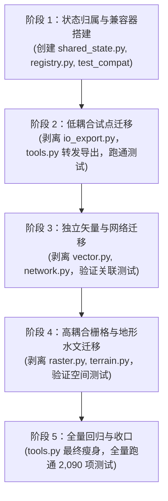

# tools.py 分阶段模块化迁移与 /teamwork 实施方案

## 1. 核心现状与边界核验

> 下方“迁移前规模”与“2,090 项测试”是本计划建立时的历史基线，不代表当前工作树规模或当前收集到的测试数。

- **迁移前代码基线**：计划建立时记录 `backend/services/tools.py` 约 **671 KB、14,115 行、273 个函数/类**；这是历史快照。
- **当前工作树核查（2026-11-15）**：`tools.py` 为 **6,448 行**；`tool_modules/` 包含 `common.py`、`io_export.py`、`network.py`、`raster.py`、`runtime.py`、`terrain.py`、`vector.py`。低耦合导出域已迁出 `export_layer` 实现与 GeoDataFrame 构造 helper；门面仍重导出 `_geojson_to_export_gdf` 兼容符号供其他工具调用。独立 `shared_state.py` 和 `registry.py` 仍未建立，`tools.py` 也远未收口为薄门面。
- **当前验证边界**：2026-11-15 本轮针对测试隔离改动合并运行 453 项通过、1 条 pandas 日期解析 warning；未重跑后端全量测试。此前“2,090 项”仅为计划初始基线，后端全量通过仍是最终验收红线。
- **兼容性门禁进度**：已新增 `backend/tests/test_tool_modules_compat.py`，检查门面重导出的可变共享状态身份、输出目录动态转发，以及 vector/network/raster/terrain 对 runtime 注册表的单一引用；首轮 3 项通过。它是当前覆盖点，不等于全部公开符号兼容性审计完成。
- **核心风险点**：
  1. **导入遮蔽（Import Shadowing）**：绝不能同名共存 `backend/services/tools.py` 与 `backend/services/tools/`，否则在不同运行环境和导入语法下会触发模块与包的解析冲突。
  2. **隐式全局状态耦合**：文件中存在 `_registered_layers`、`_tile_cache`、`_geocode_cache`、`_custom_proxy`、任务上下文锁等，必须先确立“状态唯一归属”，严防拆分后产生状态分裂或多份副本。

---

## 2. 目标架构设计

采用独立子包 `tool_modules/`，原 `tools.py` 退化为薄兼容门面（Facade）：

```text
backend/services/
├── tools.py                     # 唯一兼容门面：重导出公开符号、组装注册表、转发状态访问
└── tool_modules/
    ├── __init__.py
    ├── shared_state.py          # 状态归属中心：图层注册表、锁、缓存、代理配置与存取方法
    ├── registry.py              # 工具注册中心：@tool 注册与 _TOOL_REGISTRY 组装调度
    ├── io_export.py             # 领域 1（低耦合）：Shapefile、GeoJSON、COG、GeoPackage 导出
    ├── vector.py                # 领域 2（中耦合）：缓冲区、相交、裁剪、空间关联、质心等矢量分析
    ├── network.py               # 领域 3（中耦合）：最短路径、可达圈、服务区凸包计算
    ├── raster.py                # 领域 4（高耦合）：栅格计算器、重采样、重分类、波段代数
    └── terrain.py               # 领域 5（高耦合）：DEM 坡度、坡向、山体阴影、汇流与水文计算
```

### 状态归属原则
所有原先在 `tools.py` 内的全局变量转移至 `tool_modules/shared_state.py`。
`tools.py` 通过引用绑定重导出（例如 `_registered_layers = shared_state._registered_layers`），或通过属性转发确保读取和原地就改时操作的是同一个字典/对象。

---

## 3. 分阶段迁移步骤 (Staged Migration)

禁止多个 Agent 一窝蜂直接修改 `tools.py`，必须按明确的依赖序推进：



1. **阶段 1：骨架与状态收拢**
   - 新建 `backend/services/tool_modules/shared_state.py` 与 `registry.py`。
   - 新建兼容性测试套件 `backend/tests/test_tool_modules_compat.py`，冻结 `tools.py` 现有公开符号与全局变量签名。
2. **阶段 2：低耦合先行试点（`io_export.py`）**
   - 提取文件转换与导出相关逻辑（代码纯度高、对外部全局状态依赖少）。
   - 在 `tools.py` 补充符号重导出，运行对应测试确认无损。
3. **阶段 3：矢量与网络分析解耦（`vector.py` / `network.py`）**
   - 依赖 `shared_state` 的图层解析与数据提取。
   - 验证 `backend/tests/layered/test_layer3_gis_tools.py` 等相关测试。
4. **阶段 4：栅格与地形水文解耦（`raster.py` / `terrain.py`）**
   - 处理 DEM Provider 与复杂缓存逻辑。
   - 验证栅格重投影、坡度计算等高耦合逻辑。
5. **阶段 5：收口与全量回归**
   - `tools.py` 彻底精简为纯导入代理与门面。
   - 运行全量 2,090 项测试无失败。

---

## 4. 修正后的 /teamwork 启动 Prompt

```text
/teamwork 对 Gis-WorkTable 的 14,115 行巨石服务 backend/services/tools.py 启动分阶段模块化迁移。

【核心原则】
1. 架构方案：保留 backend/services/tools.py 作为向后兼容门面，新建 backend/services/tool_modules/ 目录承载实现，严防模块/包同名遮蔽。
2. 状态先行：必须先在 tool_modules/shared_state.py 中统一定义图层注册表、锁、缓存及代理配置，tools.py 仅做兼容转发，禁止多重副本。
3. 验收红线：现有全部 2,090 项 pytest 测试必须保持 100% 通过，不得为了迁移删改既有断言。

【分工与推进时序】
- Agent A (架构与状态)：负责建立 tool_modules/shared_state.py、registry.py 及符号兼容性测试，定义模块切分标准；
- Agent B (IO与矢量分片)：先迁移低耦合的 io_export.py，再迁移 vector.py 与 network.py，每完成一个切片即在 tools.py 建立导出并跑对应测试；
- Agent C (栅格与地形水文)：负责高耦合的 raster.py 与 terrain.py 迁移，理顺 DEM 与缓存调用；
- Agent D (流水线审计与回归)：统筹分阶段验收，监督 tools.py 符号完整性，最终运行全量 2,090 项测试并生成迁移前后行数与架构对照报告。
```
